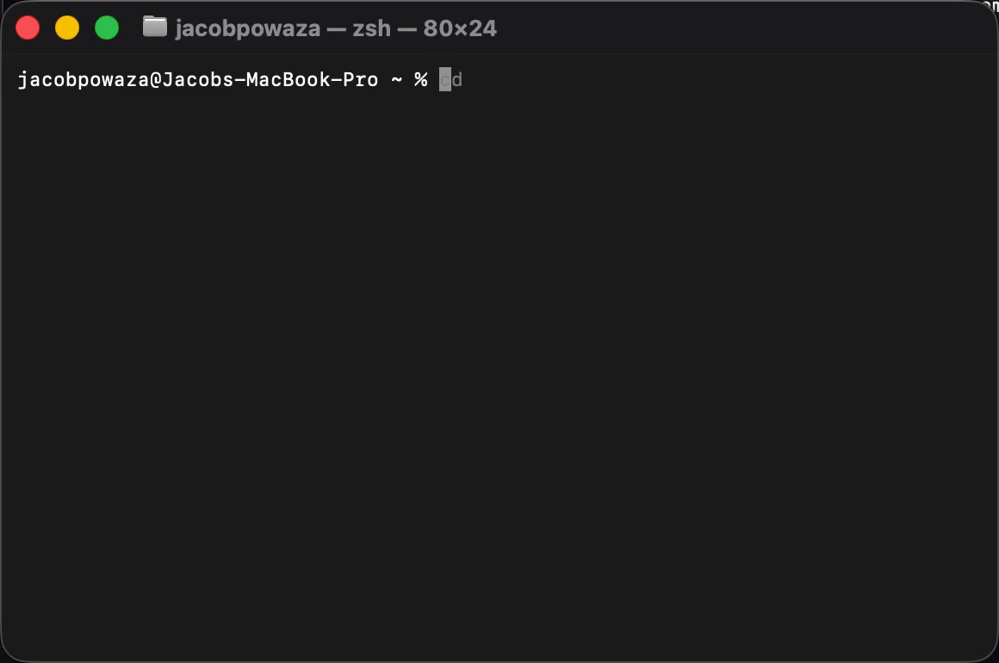

# Adaptive

Intelligent shell completion that learns commands instead of requiring giant completion scripts.



```console
$ git clone https://github.com/jacobpowaza/
  jacobpowaza/NewKap.git          jacobpowaza/Relay.git  jacobpowaza/VulnClaw.git
  jacobpowaza/continuum.git       jacobpowaza/n8n-workflows.git
  jacobpowaza/relay-plugins.git   jacobpowaza/software-mri.git
```

Adaptive discovers what a command accepts, resolves what the current argument means, and ranks useful values from local context and learned habits. Its best recommendation appears as inline ghost text; Tab accepts it and Shift-TAB lists every candidate.

> [!NOTE]
> Adaptive ships complete Zsh and Bash frontends over the same query protocol. On Bash it speaks both GNU Readline and ble.sh. The engine is shell-independent; a Fish frontend is planned.

## Install

```sh
curl -fsSL https://raw.githubusercontent.com/jacobpowaza/adaptive-zsh-completions/main/install.sh | sh
```

The installer verifies release checksums, installs `adaptive` in `~/.local/bin`, backs up your shell's rc file, and adds one marked, idempotent block. It wires up Zsh, Bash, or both, depending on the shell it detects (override with `ADAPTIVE_SHELL=bash|zsh|both`). If a binary is unavailable for the machine, it falls back to a local Cargo build.

Restart your shell, then check the installation:

```sh
adaptive doctor
```

To install with a different acceptance key, pass a Zsh `bindkey` sequence to the installer:

```sh
curl -fsSL https://raw.githubusercontent.com/jacobpowaza/adaptive-zsh-completions/main/install.sh | ADAPTIVE_ACCEPT_KEY='^F' sh
```

The Bash frontends take their own keys: `ADAPTIVE_BASH_ACCEPT_KEY` (the key
that accepts the inline suggestion) and `ADAPTIVE_BASH_BROWSE_KEY` (the key
that lists candidates), both in the same caret notation.

```sh
curl -fsSL https://raw.githubusercontent.com/jacobpowaza/adaptive-zsh-completions/main/install.sh | ADAPTIVE_SHELL=bash ADAPTIVE_BASH_ACCEPT_KEY='^[[C' sh
```

For a source checkout:

```sh
make install
```

To uninstall:

```sh
curl -fsSL https://raw.githubusercontent.com/jacobpowaza/adaptive-zsh-completions/main/uninstall.sh | sh
```

The uninstaller backs up your rc file, removes only Adaptive's managed block and binary, and leaves local cache/history in place.

## What it completes

- Flags, subcommands, arguments, aliases, and enum values parsed from common `--help` formats
- Lazily discovered nested commands such as `docker compose up`
- Cobra-style native structured completions when safely detected
- Files and directories for `cd`, `cat`, `code`, `ls`, and `open`
- Local Git branches and remotes for `checkout`, `switch`, `push`, and `remote`
- Public GitHub, GitLab, Codeberg/Forgejo, Gitea, and Bitbucket repositories in HTTPS and SSH clone URL forms
- npm, pnpm, and Yarn scripts from the nearest `package.json`
- SSH aliases from `~/.ssh/config` and non-hashed `known_hosts` entries
- Docker container names for `exec` and `logs`, when Docker is responsive
- Sanitized local usage memory that personalizes ranking and outranks global defaults once you have habits
- Predicted next tokens before you type them: `brew ` suggests `install`, `docker compose ` suggests `up`, `git ` suggests `status` inside a repository and `clone` outside one

Ranking asks what you are most likely to type next, not which strings match what you typed. It combines position validity, how commonly a token is used there by anyone, and your own frequency and recency — so subcommands come before flags at a subcommand position, common defaults win on a fresh install, and your habits take over once you have them. The global half is data, not special cases: see [usage priors](docs/configuration.md#usage-priors) to extend it for your own tools.

For example:


```console
$ claude --dang
         erously-skip-permissions

$ npm run de
  dev     vite
  deploy  node deploy.js

$ git checkout fea
  feature/completion-engine
```

## How it differs

`zsh-autosuggestions` predicts from raw history lines. Adaptive discovers command structure and contextual values, then ranks against a structured learned profile of your habits — per-position transitions, command sequences, directory affinities, accept/reject feedback — blended with global usage priors.

Static completion repositories encode each CLI as a large shell function. Adaptive stores a generic command schema and keeps command-specific code limited to small adapters for dynamic values that cannot be inferred from help.

Adaptive's parser, ranking, cache, learning, query protocol, and ZLE frontend are implemented in this repository. It does not wrap, source, copy, or depend at runtime on zsh-autosuggestions, Oh My Zsh, or a static completion collection. The Rust crates in `Cargo.lock` provide ordinary low-level facilities such as TLS, serialization, and CLI argument parsing; they are not completion engines.

Claude, Codex, and other installed CLIs are not encoded as special cases. Adaptive discovers their current flags and subcommands from native completion metadata and safe `--help`/`-h`/`help`/man interfaces, then caches the resulting schema against the executable fingerprint.

## Zsh controls

- The highest-ranked command, flag, branch, directory, script, or repository recommendation stays inline in dark gray.
- Tab accepts the inline ghost suggestion as a whole (a chain prediction completes the entire remembered line). When no ghost is visible it reveals related commands, flags, or current-directory entries instead.
- Shift-TAB is the dedicated browse key: from any state -- including while a ghost is showing -- it lists every candidate with the predicted pick pre-highlighted; Tab then accepts the highlighted entry and arrows move the selection. Set `ADAPTIVE_BROWSE_KEY` before initialization to change it.
- Repository candidates appear automatically after a recognized forge owner path such as `https://github.com/example/`.
- Right arrow cycles visible candidates; Up/Down work too. Set `ADAPTIVE_ACCEPT_KEY` or `ADAPTIVE_MENU_NEXT_KEY` before initialization to change those keys.
- Ctrl-X suppresses suggestions for the whole shell session (press again to restore). Dismissing with ESC only clears the current line and counts as a learned rejection. Set `ADAPTIVE_SUPPRESS_KEY` to change it.
- Shift-Right / Shift-Left cycle how far fuzzy matches may sprawl (tight -> smart -> loose -> tight), persisting globally and repainting the ghost immediately. Set `ADAPTIVE_CYCLE_FUZZY_KEY` / `ADAPTIVE_CYCLE_FUZZY_BACK_KEY` to change them (tmux users may need `set -g xterm-keys on`).
- Shift-Up toggles whole-command prediction on an untouched prompt (persisted globally). Set `ADAPTIVE_TOGGLE_EMPTY_KEY` to change it.
- Set `ADAPTIVE_GHOST_STYLE` to any ZLE highlight style before initialization to change the inline color.
- Enter always runs the line exactly as typed; accepting or dismissing suggestions never executes anything.
- Outside an Adaptive suggestion/menu, the widgets delegate to normal ZLE behavior. `bindkey -e` is supported.

### The daemon

When a server is reachable (`adaptive daemon start`, or automatic on first use from the Zsh integration), every keystroke is one sub-millisecond request over a Unix socket to a single process that holds the usage profile in memory -- no binary launches while you type. If the daemon dies mid-session the frontend transparently falls back to spawning one-shot query processes, so nothing breaks. It exits by itself after 15 idle minutes, and `adaptive doctor` reports whether a running server matches your installed version.

## Bash

Adaptive ships two Bash frontends. Both drive the same engine over the same
protocol as the Zsh one, and the installer picks between them for you.

**ble.sh** replaces Readline with a line editor written in pure Bash that
renders styled regions, so the inline suggestion can be *dimmed* -- exactly
what the Zsh frontend does. Right cycles to the next candidate, Left to the
previous one, Tab accepts the suggestion, Shift-Tab lists every candidate.

**GNU Readline** has no equivalent of ZLE's `POSTDISPLAY`: it renders exactly
the line buffer, and anything painted from outside is erased by the next
repaint. Adaptive therefore keeps the suggestion *inside* the buffer --
`READLINE_LINE` holds `<what you typed><the suggestion>` with the cursor on
the boundary -- so the suggestion stays visible and every Readline feature
(wrapping, resize, history, cursor keys) keeps working. It is not dimmed,
because Readline prints ANSI escapes literally. Right or End accepts the whole
suggestion, Ctrl-Right accepts one word of it, Ctrl-X discards it, Tab
completes normally, and Shift-Tab walks the candidate list backwards.

The installer detects ble.sh and uses it when it is installed; otherwise the
Readline frontend takes over. Both need bash >= 4.

```sh
# The installer does this for you:
curl -fsSL https://raw.githubusercontent.com/jacobpowaza/adaptive-zsh-completions/main/install.sh | sh
```

To wire Bash up by hand, add one line to `~/.bashrc`:

```sh
eval "$(adaptive init bash)"
```

`adaptive init blesh` generates the ble.sh frontend instead. Both frontends
share one runtime (`adaptive-core.bash`) that the generated script sources, so
nothing is launched at shell startup.

Bootstrap the usage profile from your existing history once:

```sh
adaptive history import ~/.bash_history
```

## CLI

```text
adaptive init zsh
adaptive init bash
adaptive init blesh
adaptive doctor
adaptive query --buffer 'git clone' --list
adaptive query --buffer '' --prev 'make test'
adaptive serve --idle-exit-secs 900
adaptive daemon start
adaptive daemon stop
adaptive daemon status
adaptive fuzzy            # show the sprawl ladder and examples
adaptive fuzzy cycle      # tight -> smart -> loose -> tight
adaptive empty off        # no predictions on an untouched prompt
adaptive discover git
adaptive discover docker compose
adaptive inspect git
adaptive cache status
adaptive cache refresh git
adaptive cache prune
adaptive cache clear
adaptive carapace status
adaptive carapace enable
adaptive carapace disable
adaptive history status
adaptive history import [file]
adaptive history feedback accept --context KEY --value VALUE
adaptive history clear
adaptive history disable
adaptive version
```

`adaptive query` is the stable frontend protocol. It emits JSON by default and a sanitized tab-separated stream for the Zsh integration. The additive `--list` flag keeps related alternatives for an explicit listing request (Shift-TAB) while ordinary queries remain prefix-focused. `--prev LINE` feeds command-sequence learning so an empty prompt can predict what usually follows the last command. Queries served through a running daemon answer in well under a millisecond; `--no-daemon` (or `ADAPTIVE_NO_DAEMON=1`) forces the direct path.

## Architecture

```text
shell buffer
  parser -> resolver -> discovery/cache -> contextual providers
                                     \-> learned profile + global priors
                candidates -> normalizer/ranker -> shell protocol
                                                   |- ghost text
                                                   `- candidate list

optional daemon: one process, profile in memory, Unix socket per user;
                 every terminal shares it, queries stay sub-millisecond
```

Discovery only invokes bounded informational interfaces: known native completion endpoints, `--help`, `help`, and lazily reached subcommand help. Schemas are cached against an executable path/size/mtime fingerprint. Official documentation retrieval is optional, allowlisted by command, size-limited, treated as untrusted data, and never evaluated.

## Privacy and security

Adaptive has no telemetry. Shell history never leaves the machine. A sanitizer rejects multiline pastes, token-shaped strings, credential keywords, large random values, private-key material patterns, and oversized commands before persistence — and the same forgetting rules your shell uses apply before anything is learned: a leading space (the `HIST_IGNORE_SPACE` convention) or a `HISTORY_IGNORE` pattern keeps a line out of the usage profile, including during `history import`. GitHub credentials may be read from `GH_TOKEN`, `GITHUB_TOKEN`, or an authenticated `gh`, but are kept only in process memory and never logged or cached.

Remote data is length-limited and rejected if it contains control characters, tabs, newlines, NUL, or terminal escapes. Suggestions are inserted as text and are never executed automatically. See [SECURITY.md](SECURITY.md) for the threat model and reporting process.

The daemon's socket lives under the same private data directory (`0600`), so only your account can talk to it.

## Configuration

Adaptive works without a config file. It uses the platform config directory: `~/.config/adaptive/config.toml` on XDG systems and `~/Library/Application Support/adaptive/config.toml` on macOS.

```toml
[completion]
history = true
online_docs = false
fuzzy = true
fuzzy_preset = "smart"   # how far fuzzy matches may sprawl: tight | smart | loose
predictive = true        # ghost the next token at untyped positions
chain_prediction = true  # complete to whole remembered command lines
half_life_days = 21.0    # recency decay for learned habits

[ui]
ghost_text = true
max_candidates = 8
empty_prompt_predictions = true  # predict a whole command before you type

[providers.forge]
enabled = true

[providers.docker]
enabled = true

# Optional external completion engine; auto-detected on PATH.
[carapace]
enabled = true

[privacy]
telemetry = false
```

Environment overrides beat the file for one shell at a time: `ADAPTIVE_FUZZY=tight|smart|loose` and `ADAPTIVE_EMPTY=on|off`.

### Optional: Carapace

If [carapace-bin](https://carapace-sh.github.io/carapace-bin/) is installed, Adaptive merges its exact command knowledge (subcommands, flags, enums, positionals for hundreds of CLIs) into every query, then ranks your learned habits above it. Nothing is required: without carapace everything works as before, and `adaptive carapace disable` turns the source off without uninstalling anything. Answers are cached against a fingerprint of the carapace binary with a hard 400 ms timeout, so completion stays instant and a broken carapace can never stall the shell.

## Development

Rust 1.85 or newer is required.

```sh
make test
make check
make build
./tests/install.sh
```

Provider contributions implement one narrow matching/resolution interface; ranking, cache, timeouts, sanitization, and display remain in the engine. Start with [docs/providers.md](docs/providers.md) and [CONTRIBUTING.md](CONTRIBUTING.md).

## Roadmap

- Fish frontend over the existing query protocol
- More native completion adapters and structured documentation parsers
- Workspace-aware npm/pnpm package glob expansion
- Background refresh for stale schemas and provider caches
- Terminal recording and broader ZLE compatibility matrix

Adaptive is MIT licensed.
